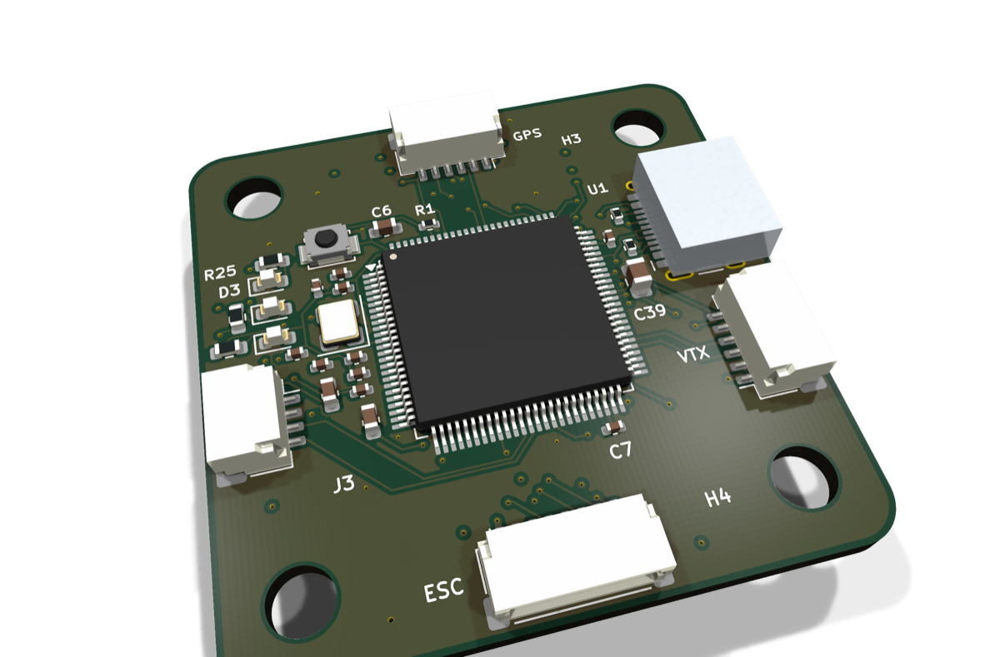
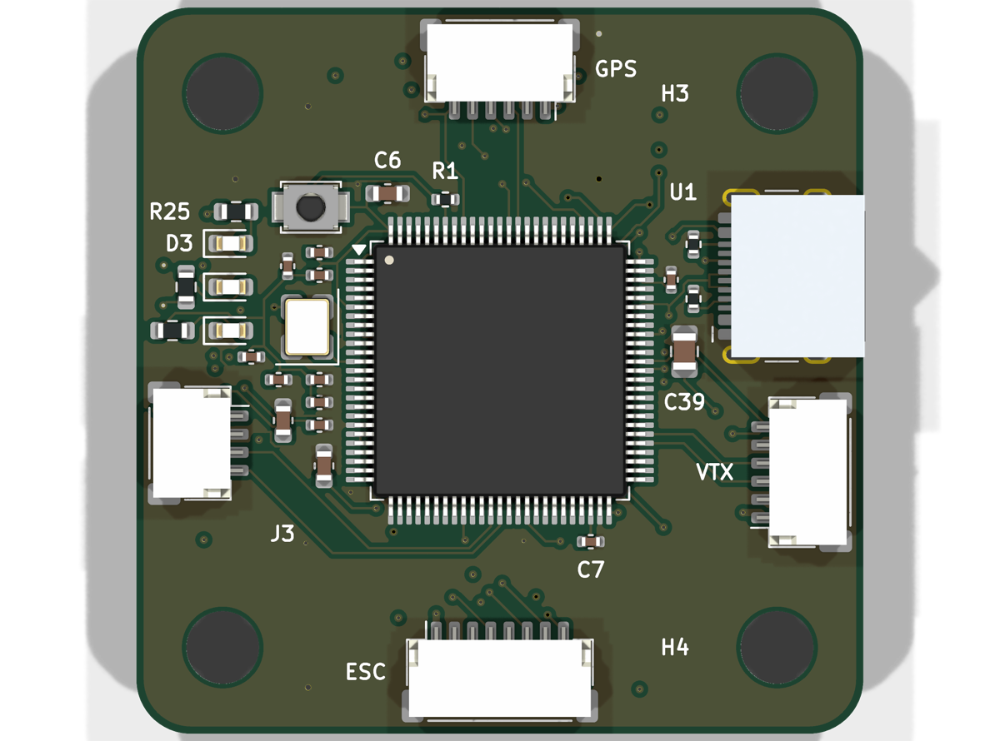
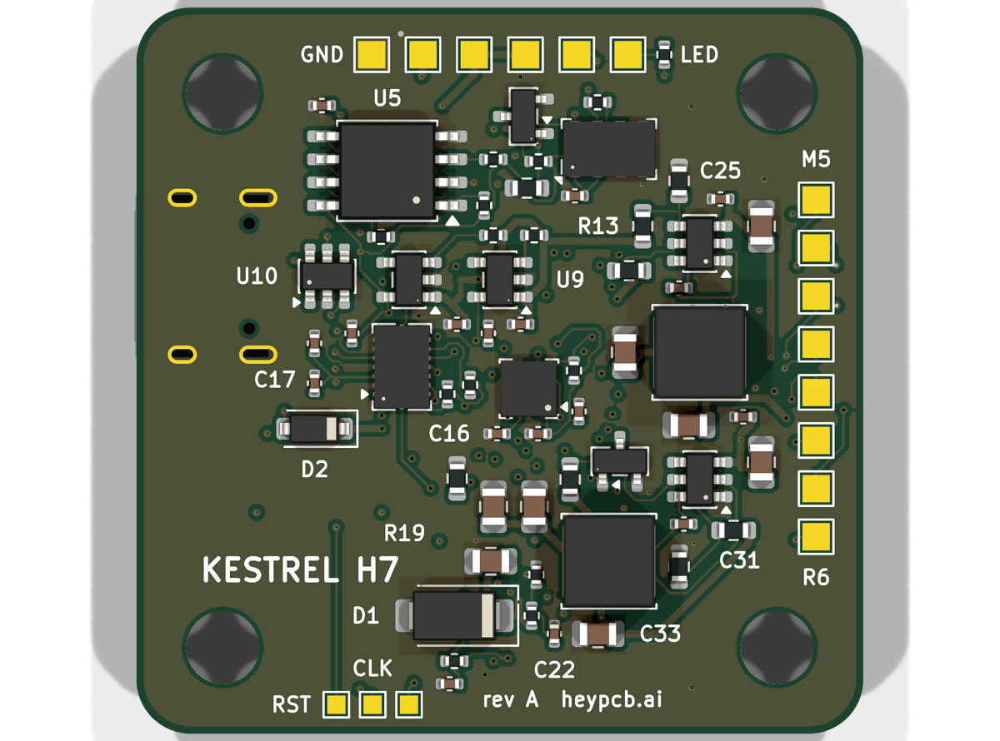

# Kestrel H7: FPV flight controller

**An STM32H743 flight controller for 5-inch 6S quads: two IMUs, a barometer, a 16 MB blackbox and its own 5 V and switchable 10 V BECs, on a 30.5 mm stack.**

The Kestrel H7 is the flight controller of [Kestrel](https://github.com/HeyPCB/kestrel), a 5-inch 6S FPV quad's electronics. Its pin map follows Betaflight's `MATEKH743` target wherever the functions match, so its timer and DMA assignments are proven ones; a Betaflight unified target and CLI defaults are in [`firmware/`](firmware/). The ICM-20602 flies Betaflight, and the BMI088 on its own SPI bus is there for INAV and ArduPilot.

| Layers | Size | Footprints (LCSC parts) | Nets | Connections routed | Routed vias | ERC errors / warnings | DRC errors / warnings / unconnected / parity | Parts per board, 10-board build |
|---|---|---|---|---|---|---|---|---|
| 6 | 40 x 40 mm | 114 (93) | 84 | 277 -> 0 open | 125 | 0 / 0 | 0 / 0 / 0 / 0 | $46.49 |

**Not fabricated, assembled, powered or flown yet.** Every number on this page is measured by KiCad
10.0.6 on the files in this repository ([`report.json`](report.json), [`fab/erc.json`](fab/erc.json),
[`fab/drc.json`](fab/drc.json)) or read from the live JLC/LCSC catalogue ([`bom_cost.md`](bom_cost.md):
parts only, at a 10-board build's price tier with JLC's Extended-part fee; the bare PCB and assembly are
quoted at order time).

| | |
|---|---|
| The whole drone: spec, build guide, BOM, measured results | [HeyPCB/kestrel](https://github.com/HeyPCB/kestrel) |
| KiCad 10 project | [`kicad/`](kicad/) |
| Gerbers, drill, BOM, CPL, STEP, schematic PDF | [`fab/`](fab/) |
| Firmware | [`firmware/betaflight/KESTRELH7/`](firmware/betaflight/KESTRELH7/): Betaflight unified target and CLI defaults |
| Renders | [front](media/top.png), [back](media/bottom.png), [hero](media/hero.png), [Circuit World thumbnail](media/circuit-world.png) |
| Brief and generator | [`design/`](design/) |

 

## What's on it

- **MCU:** STM32H743VIT6 (LQFP-100, 480 MHz, 2 MB flash), 8 MHz crystal, BOOT button, SWD pads.
- **IMUs:** ICM-20602 on SPI1 with its own interrupt (Betaflight's gyro); BMI088 on SPI4 (INAV and ArduPilot). Both run from their own AP2112K LDO, away from the BECs' switching.
- **Baro:** MS5611 on I2C1 at 0x77 (cover it with open-cell foam).
- **Blackbox:** W25Q128JV, 16 MB, on SPI3.
- **Power:** 2-6S from the ESC harness, SMAJ30A TVS, VBAT x 1/11 to an ADC; a 5 V BEC (LMR51430, 2 A budget) and a 10 V BEC for the VTX that PINIO1 switches off.
- **Ports:** JST-SH ESC 8-pin, VTX 6-pin, receiver 4-pin and GPS 6-pin; USB-C with USBLC6 ESD.
- **Pads:** M5-M8, UART1 and UART6, LED strip, buzzer, 5 V, 10 V, GND (the pad map is in the hub's [BUILD.md](https://github.com/HeyPCB/kestrel/blob/main/BUILD.md)).

## Ordering

6 layers, 1.6 mm, 1 oz copper; parts on both faces. Upload [`fab/kestrel_fc_gerbers.zip`](fab/kestrel_fc_gerbers.zip), [`fab/kestrel_fc_bom.csv`](fab/kestrel_fc_bom.csv)
and [`fab/kestrel_fc_cpl_jlc.csv`](fab/kestrel_fc_cpl_jlc.csv) to JLCPCB: every part has an LCSC number.
Bring-up, one board at a time, is in the hub's [BUILD.md](https://github.com/HeyPCB/kestrel/blob/main/BUILD.md).

## How it was made

Designed with the HeyPCB method on KiCad 10.0.6, headless, by the `heypcb-kicad` pipeline: a written brief composed from reusable circuit blocks, every pin from KiCad's own symbol library, every part bound to an LCSC number from a dated catalogue read, then ERC, a netlist round trip, locked placement, Freerouting 2.4.1, pours and stitching, silkscreen, DRC with schematic parity, DFM and a fab gate, each stage gated by a measurement. [`design/make_brief.py`](design/make_brief.py) regenerates the brief (outline, part locks, net
classes) from code.

Part of [Kestrel](https://github.com/HeyPCB/kestrel), a 5-inch 6S FPV quad's electronics.

## License

Hardware: [CERN-OHL-S v2](LICENSE). The Betaflight target in [`firmware/`](firmware/) is GPL-3.0 ([`firmware/LICENSE`](firmware/LICENSE)), the licence of the betaflight/config repository it builds in, whose `MATEKH743` timer and DMA assignments it reuses. KiCad's symbol, footprint and 3D libraries used in the
design are CC-BY-SA 4.0 with the KiCad library exception.
